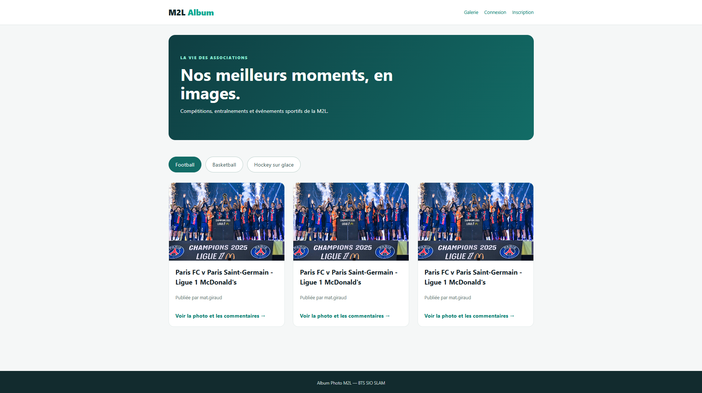
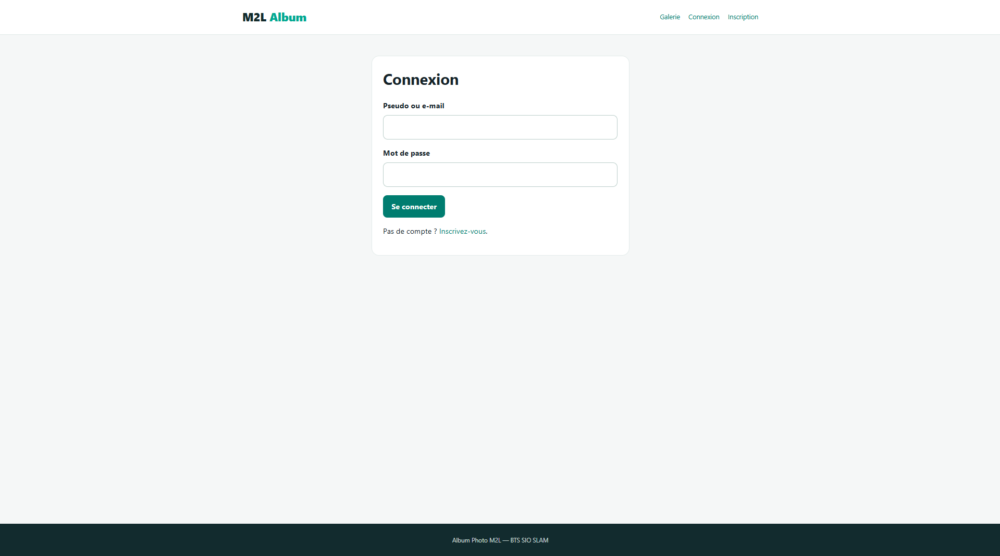
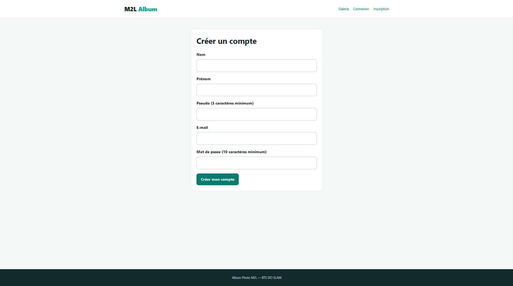
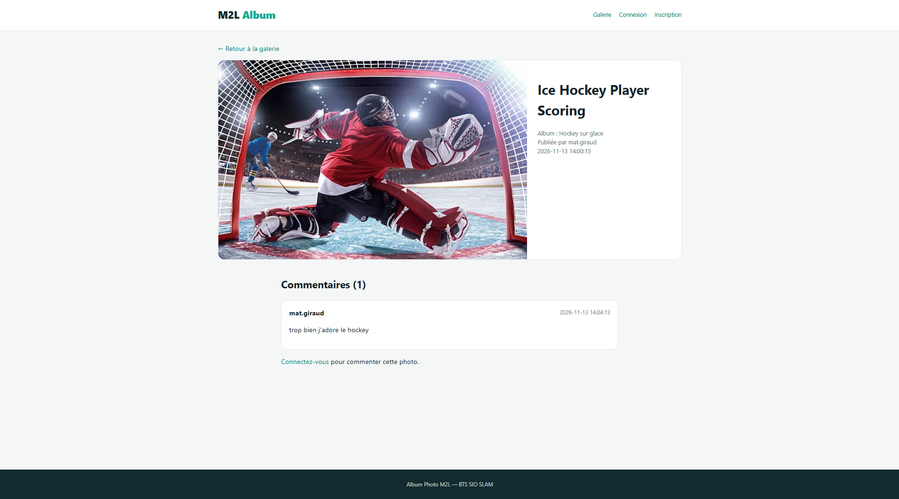
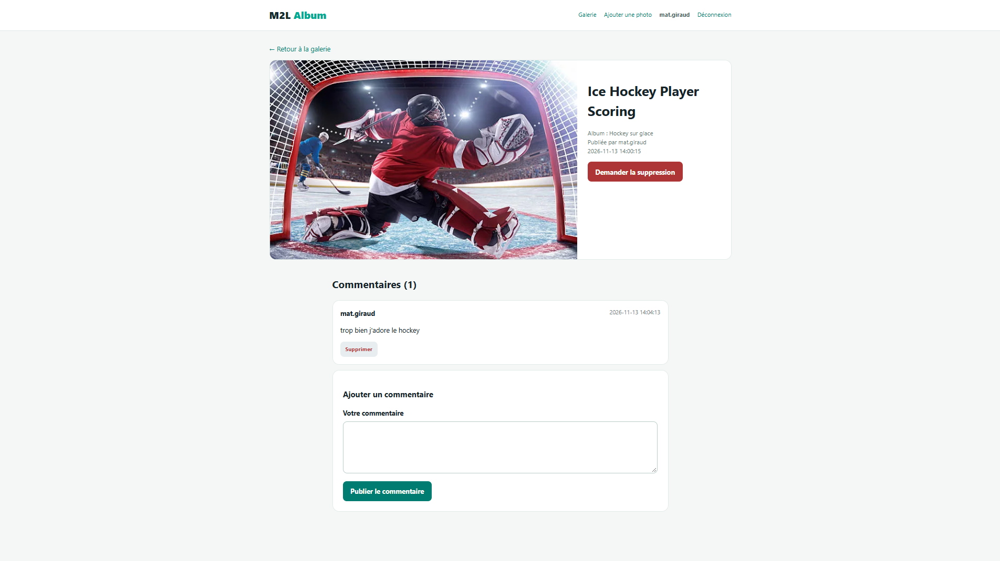
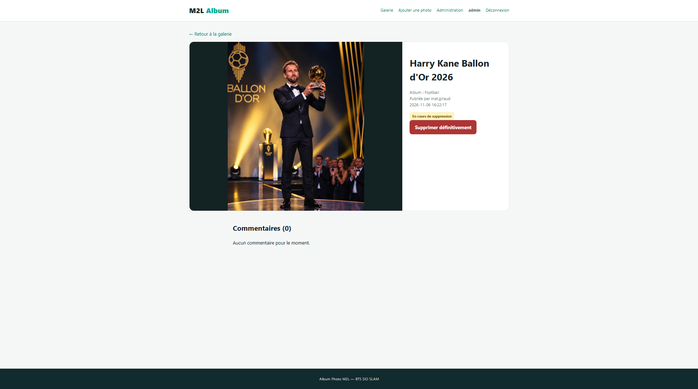
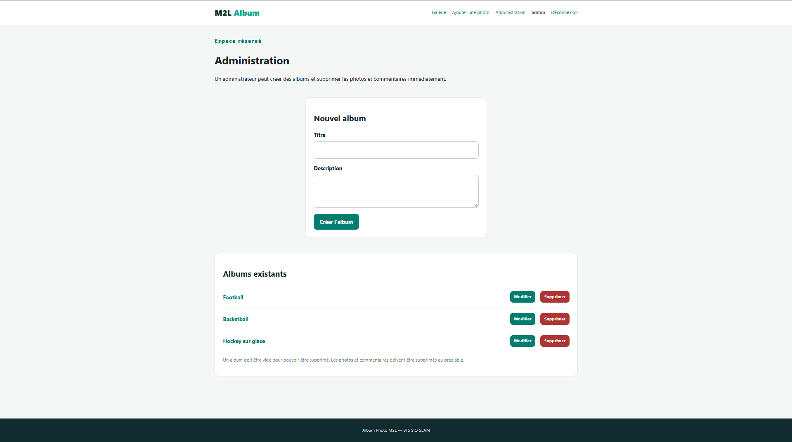
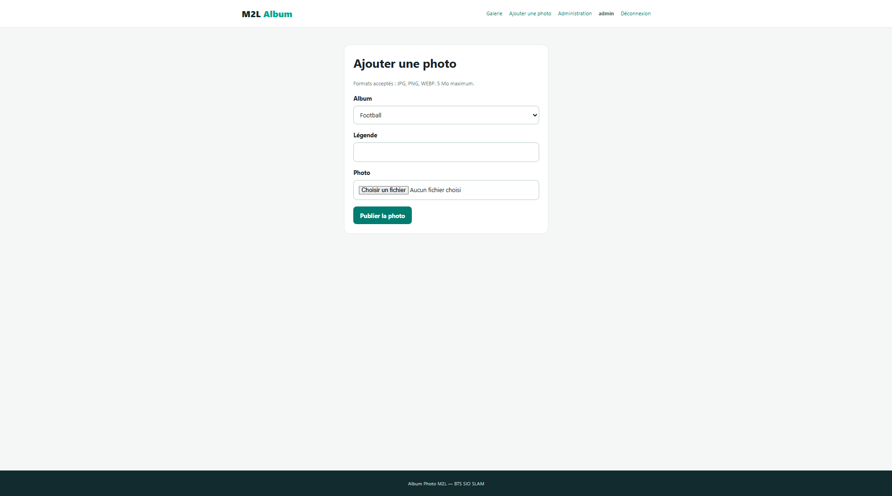

# Documentation technique — Album Photo M2L

**Formation :** BTS SIO — Option SLAM, 2ᵉ année  
**Étudiant :** GIRAUD VINCELOT Mathis  
**Année scolaire :** 2026-2027

---

## 1. Présentation du projet

Dans le cadre du BTS SIO SLAM, j'ai développé un album photo en ligne destiné aux associations sportives de la Maison des Ligues de Lorraine (M2L).

Le site permet aux visiteurs de consulter des photos classées par albums sportifs ainsi que leurs commentaires. Les utilisateurs connectés peuvent publier des photos, écrire des commentaires et demander la suppression de leurs propres publications. Les administrateurs peuvent gérer les albums et modérer les contenus.

Les captures ci-dessous présentent les interfaces de l'application **selon le type d'utilisateur** : visiteur, membre ou administrateur.

## 2. Choix techniques

- **PHP 8** : traitement des demandes, formulaires et authentification.
- **HTML5 / CSS3** : structure, mise en page et galerie responsive.
- **MySQL** : stockage des utilisateurs, albums, photos et commentaires.
- **PDO** : accès à la base et requêtes préparées.
- **Sessions PHP** : conservation de l'authentification entre les pages.
- **Architecture MVC** : séparation du traitement, des données et de l'affichage.

### 2.1. Architecture MVC

| Composant   | Emplacement        | Rôle                                                             |
| ----------- | ------------------ | ---------------------------------------------------------------- |
| Modèles     | `app/models/`      | Requêtes SQL et accès aux tables.                                |
| Contrôleurs | `app/controllers/` | Validation des données, contrôles d'accès et appels aux modèles. |
| Vues        | `app/views/`       | Pages HTML/PHP, formulaires et affichage des données.            |
| Routeur     | `public/index.php` | Point d'entrée unique qui associe les actions aux contrôleurs.   |

## 3. Base de données

La base repose sur quatre tables :

- `utilisateur` : informations des comptes et rôle (`membre` ou `admin`).
- `page` : albums sportifs, avec titre et description.
- `photo` : fichier image, légende, auteur, album et état de suppression.
- `commentaire` : texte, auteur, photo concernée et état de suppression.

Chaque photo est associée à une seule page et à un utilisateur. Chaque commentaire concerne une seule photo et possède un auteur.

Les relations et cardinalités figurent dans `MCD_MLD.md` (document de conception séparé). Le script de création est disponible dans `sql/album_photo_m2l.sql` dans le projet principal.

## 4. Gestion des rôles

Trois situations d'accès sont prévues : **visiteur non connecté**, **membre connecté** et **administrateur connecté**. Le visiteur n'est pas un rôle enregistré dans MySQL.

| Fonctionnalité                                | Visiteur | Membre | Administrateur |
| --------------------------------------------- | :------: | :----: | :------------: |
| Consulter les albums et photos actifs         |   Oui    |  Oui   |      Oui       |
| Lire les commentaires actifs                  |   Oui    |  Oui   |      Oui       |
| S'inscrire et se connecter                    |   Oui    |   —    |       —        |
| Ajouter des photos et commentaires            |   Non    |  Oui   |      Oui       |
| Demander la suppression de ses publications   |   Non    |  Oui   |     Oui\*      |
| Voir les publications en cours de suppression |   Non    |  Non   |      Oui       |
| Supprimer immédiatement les publications      |   Non    |  Non   |      Oui       |
| Créer, modifier et supprimer des albums vides |   Non    |  Non   |      Oui       |

_L'administrateur dispose de la suppression immédiate, sans attendre 15 jours._

## 5. Captures d'écran de l'application

Les captures suivantes illustrent **l'interface telle qu'elle apparaît dans le projet**. Elles présentent les différences visibles entre les profils ; les contrôles d'autorisation doivent aussi être vérifiés dans les contrôleurs PHP.

### 5.1. Visiteur — Galerie et albums publics



**Figure 1 — Galerie publique.** Le visiteur peut choisir un album (Football, Basketball, Hockey sur glace) grâce aux onglets. Les photos apparaissent sous forme de cartes de taille homogène, avec légende, auteur et lien vers le détail.

### 5.2. Visiteur — Connexion



**Figure 2 — Connexion.** Un utilisateur existant renseigne son pseudo ou adresse e-mail et son mot de passe pour accéder aux fonctions réservées aux comptes connectés.

### 5.3. Visiteur — Inscription



**Figure 3 — Inscription.** Le formulaire permet de créer un compte avec nom, prénom, pseudo, adresse e-mail et mot de passe. Un nouveau compte reçoit normalement le rôle `membre`.

### 5.4. Visiteur — Détail d'une photo et lecture des commentaires



**Figure 4 — Détail d'une photo en mode visiteur.** La photo, sa légende, son album et son auteur sont visibles. Les commentaires sont publics, mais le visiteur est invité à se connecter pour en écrire un.

### 5.5. Membre connecté — Publication et suppression différée



**Figure 5 — Vue membre.** Le membre connecté peut rédiger un commentaire. Lorsqu'il consulte sa propre photo, il voit le bouton **« Demander la suppression »**. Cette action déclenche une période d'attente avant la suppression définitive.

### 5.6. Administrateur — Photo en attente de suppression



**Figure 6 — Modération d'une photo archivée.** L'administrateur peut encore voir une photo marquée **« En cours de suppression »** et dispose du bouton **« Supprimer définitivement »**.

### 5.7. Administrateur — Photo et gestion des commentaires


**Figure 7 — Gestion du contenu en tant qu'administrateur.** L'administrateur peut supprimer immédiatement une photo et modérer les commentaires. Le formulaire d'ajout de commentaire reste disponible lorsqu'il est connecté.

### 5.8. Administrateur — Gestion des albums



**Figure 8 — Espace Administration.** Un administrateur peut créer un album sportif en indiquant un titre et une description, puis retrouver les boutons **« Modifier »** et **« Supprimer »** dans la liste des albums existants. La suppression d'un album est limitée aux albums vides.

### 5.9. Utilisateur connecté — Ajout d'une photo



**Figure 9 — Publication d'une photo.** Le membre ou l'administrateur choisit un album, saisit une légende et sélectionne une image. L'interface indique les formats acceptés (JPG, PNG, WEBP) et la taille maximale (5 Mo).

## 6. Cybersécurité mise en place

### 6.1. Injections SQL

Les accès à la base avec des valeurs fournies par l'utilisateur utilisent des **requêtes préparées PDO** et des paramètres (`:id`, `:titre`, etc.). Les données ne sont pas concaténées directement dans le SQL.

### 6.2. XSS (Cross-Site Scripting)

Les données pouvant être saisies par les utilisateurs (pseudo, légendes, commentaires, titres d'albums) sont échappées **au moment de leur affichage HTML**, notamment via la fonction `e()` utilisant `htmlspecialchars()`.

### 6.3. Authentification et droits

Les mots de passe sont hachés, les sessions PHP maintiennent la connexion et les contrôleurs vérifient les droits avant d'effectuer les actions réservées aux membres ou aux administrateurs. Un bouton caché dans la vue ne constitue pas à lui seul une protection.

### 6.4. Envoi des images

Les fichiers envoyés sont soumis à une vérification de format et de taille avant stockage. Les images sont conservées hors du répertoire public et servies par une action dédiée du site.

## 7. Suppression différée et modération

Lorsqu'un membre demande la suppression d'une de ses photos ou d'un de ses commentaires, son statut passe à `en_attente`, avec une date de demande de suppression. Le contenu n'est alors plus visible publiquement, mais reste consultable par un administrateur avec une mention spécifique.

La durée prévue par le cahier des charges est **15 jours** (ou **2 minutes pendant les tests**). La suppression définitive automatique nécessite l'exécution régulière du script de purge par une tâche planifiée : la présence du script seule ne garantit pas son exécution.

Un administrateur peut, quant à lui, supprimer immédiatement un contenu. Supprimer définitivement une photo entraîne aussi la suppression de ses commentaires associés en base grâce à la relation SQL configurée.

## 8. Fonctionnalités supplémentaires

- Gestion des albums sportifs par un administrateur : création, modification, suppression des albums vides.
- Galerie responsive organisée en grille de trois colonnes sur ordinateur.
- Affichage d'un détail de photo et de ses commentaires.
- Interface de modération spécifique au rôle administrateur.
- Affichage distinct des contenus en attente de suppression pour l'administrateur.

## 9. Tests et vérifications à présenter

| Test                                                       | Résultat attendu                                                     |
| ---------------------------------------------------------- | -------------------------------------------------------------------- |
| Visiter la galerie sans être connecté                      | Les photos et commentaires actifs sont accessibles.                  |
| Tenter de publier sans être connecté                       | L'action est refusée ou redirigée vers la connexion.                 |
| Ajouter une photo en tant que membre                       | La photo apparaît dans le bon album.                                 |
| Demander la suppression de sa photo                        | La photo disparaît du public et reste visible pour l'administrateur. |
| Supprimer immédiatement en tant qu'administrateur          | Le contenu est retiré de la base.                                    |
| Modifier un album en tant que membre                       | La demande est refusée côté serveur.                                 |
| Supprimer un album contenant des photos                    | La suppression est refusée.                                          |
| Soumettre du texte HTML dans une légende ou un commentaire | Le texte est échappé à l'affichage, sans exécution de script.        |

## 10. Conclusion

Ce projet m'a permis de travailler sur une application PHP utilisant une architecture MVC, des formulaires, l'authentification et des rôles, ainsi qu'une base MySQL relationnelle. Il m'a également permis de mettre en pratique les protections étudiées en BTS SIO, notamment contre les injections SQL et les failles XSS.

La présentation des différentes vues montre comment l'interface et les actions disponibles évoluent selon que l'utilisateur est visiteur, membre ou administrateur.

---

### Organisation des fichiers de documentation

Pour que les images s'affichent dans VS Code et sur GitHub, conserver le document Markdown et le dossier `captures/` ensemble :

```text
Documentation_technique_Album_Photo_M2L.md
captures/
    01_galerie_publique.png
    02_connexion.png
    03_inscription.png
    04_detail_photo_visiteur.png
    05_detail_photo_membre.png
    06_photo_attente_admin.png
    07_detail_commentaires_admin.png
    08_administration_albums.png
    09_ajout_photo.png
```
