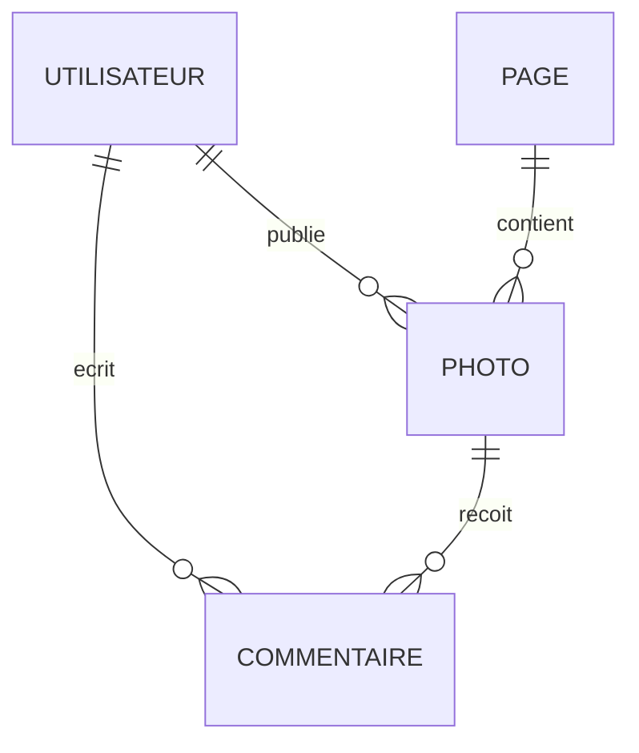

# MCD et MLD — Album photo M2L

## MCD (conceptuel)

Entités : **UTILISATEUR**, **PAGE**, **PHOTO**, **COMMENTAIRE**.

Associations et cardinalités :

- UTILISATEUR (0,N) **publie** PHOTO (1,1)
- PAGE (0,N) **contient** PHOTO (1,1)
- UTILISATEUR (0,N) **écrit** COMMENTAIRE (1,1)
- PHOTO (0,N) **reçoit** COMMENTAIRE (1,1)

Créer un diagramme MCD graphique dans Looping ou JMerise pour la remise, avec les attributs de chaque entité et les cardinalités.

## MLD (relationnel)

- UTILISATEUR(**id_utilisateur**, nom, prenom, pseudo, email, mot_de_passe, role, date_inscription)
- PAGE(**id_page**, titre, description, date_creation)
- PHOTO(**id_photo**, nom_fichier, type_mime, legende, date_ajout, statut_suppression, date_demande_suppression, #id_utilisateur, #id_page)
- COMMENTAIRE(**id_commentaire**, contenu, date_commentaire, statut_suppression, date_demande_suppression, #id_utilisateur, #id_photo)

**Gras** : clé primaire ; `#` : clé étrangère.

Les attributs `statut_suppression` et `date_demande_suppression` sont nécessaires à la conservation de 15 jours.
Le champ `type_mime` identifie le type de fichier servi par PHP.
