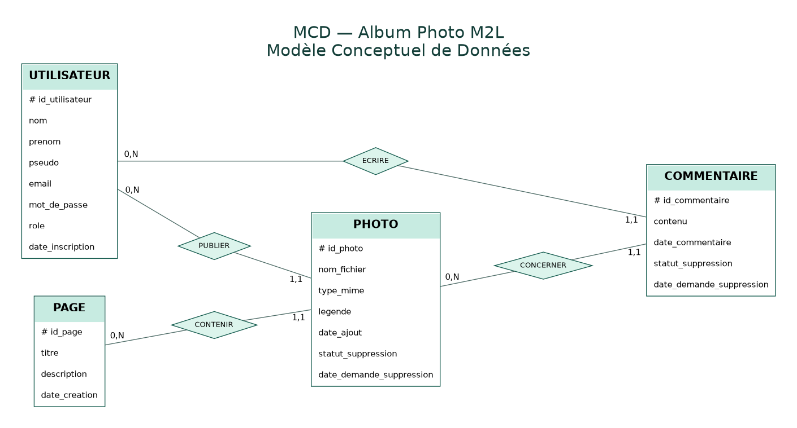
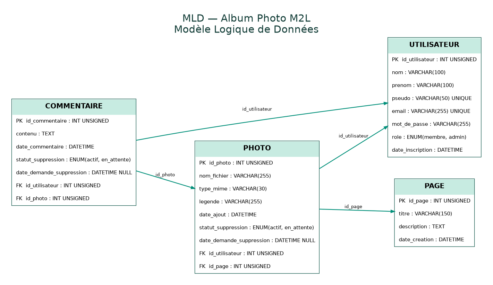

# Conception de la base de données — Album Photo M2L

## 1. Modèle Conceptuel de Données (MCD)

Chaque photo possède exactement un auteur et appartient à une seule page. Chaque commentaire possède un auteur et concerne une seule photo. Un utilisateur peut publier zéro à plusieurs photos ou commentaires. Une page peut contenir zéro à plusieurs photos ; une photo peut recevoir zéro à plusieurs commentaires.

## 2. Modèle Logique de Données (MLD)

**PK** : clé primaire ; **FK** : clé étrangère. Le rôle d'un utilisateur est `membre` ou `admin`. Les pages correspondent aux différents sports (Football, Basketball, etc.) ; la création de pages dans l'administration ne nécessite pas de table supplémentaire.

**Note** : ces schémas correspondent au script SQL présenté (quatre tables). Pour une représentation conceptuelle Merise stricte, les clés étrangères n'apparaissent que dans le MLD, pas dans le MCD.
